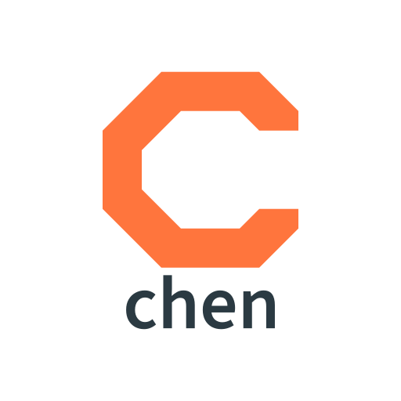

Code Hierarchy Exploration Net (chen) is a code analysis library that represents a program as a
graph and reasons about how data moves through it. The graph, a Code Property Graph, combines the
abstract syntax tree, control flow and data dependencies of a program into one queryable
structure, so a question such as "can untrusted input reach this dangerous call" becomes a graph
traversal rather than a guess.

chen is the analysis core behind AppThreat's [atom](https://github.com/AppThreat/atom), which
cdxgen and OWASP dep-scan use for reachability and usage evidence. It is written in Scala 3, runs
on the JVM, and has frontends for C, C++, Java, JVM bytecode, Android, JavaScript, TypeScript,
Python, PHP and Ruby.

[](https://github.com/cdxgen/cdxgen)

**chen 4.0** adds a C and C++ frontend built on the EDG front end, brings every language up to
its current syntax, makes the Flux solver the default for data flow, and records much more of what
each compiler knows. [What is new in 4.0](v4/README.md) summarises the release and links to
the detailed notes on the [frontends](v4/frontends.md), the [API and migration](v4/api.md),
[cpg2](v4/cpg2.md) and [overflowdb2](v4/overflowdb2.md).

## What it is for

If you build program analysis tooling, chen gives you a stable Code Property Graph, a library of
composable passes, and a traversal language for your own queries. You can add taggers, frontends
and overlays without rebuilding the foundation.

If you analyse software for security, chen follows tainted data from an attacker-controlled
source to a sensitive sink across functions, files and dependency boundaries, so you can decide
whether a reported vulnerability is reachable in your application. Because it follows data
rather than matching names, it tells a dangerous function that exists from one that is actually
reached, and it drops flows that a sanitizer or validator neutralises on the way.

chen is built for hierarchical analysis. An application is several layers stacked together: the
code you write, the libraries it uses, the container and operating system it runs in, and the
cloud it deploys to. chen is designed to reason across those layers rather than stop at a file or
language boundary.

With it you can:

- decide whether a known weakness pattern is present and reachable, given how your code actually
  calls it;
- trace taint from sources to sinks across call chains, with per-method flow summaries that keep
  the analysis fast on large, bundled or transpiled code;
- tag flows with what they carry and where they go: personal data, regulated data (`pci-dss`,
  `gdpr`, `phi-medical`), secrets, tracker SDKs, and network direction (`service-egress`,
  `service-ingress`, `on-device-ai`);
- recognise framework routes, inputs and outputs: for Java (Spring MVC and WebFlux, JAX-RS and
  Jakarta, Micronaut, servlets, Vert.x, gRPC, JDBC, JPA and MyBatis, LangChain4j, Spring AI and
  other AI SDKs, MCP server tools, cloud SDKs, Kafka, JMS and RabbitMQ listeners, JNI and the FFM
  API), JavaScript and TypeScript (Express-style routers, React, Vue, Angular, Svelte and
  SvelteKit, Next.js, Nuxt, Nest, Astro, Lit and others), Python (Django, Flask, aiohttp), PHP
  (Laravel, Symfony, WordPress) and Ruby (Rails, Sinatra);
- find memory-safety problems in C and C++ with an overlay that tracks extents, guards,
  allocation state and integer widths;
- slice a program down to what matters around a point of interest, and export graphs for other
  tools and machine learning.

## Languages

| Language | Frontend | Versions and notes | Needs |
|---|---|---|---|
| C and C++ | [c2cpg](https://github.com/AppThreat/chen/tree/main/platform/frontends/c2cpg) (Eclipse CDT) | C up to C23 and C++ up to C++23, C++20 modules, headers and preprocessed `.i` files; compilation databases | nothing; a GCC or Clang driver improves macro accuracy |
| C and C++ | [edg2atom](https://github.com/AppThreat/chen/tree/main/platform/frontends/edg2atom) (EDG) | the same languages through the EDG front end, with overloads, templates and conversions resolved | [edga](https://github.com/AppThreat/edga) 0.2.0 |
| Java | javasrc2cpg | Java 8 to 26 syntax; Lombok; sources read in the build's declared encoding | |
| JVM bytecode and Android | jimple2cpg | JARs, class files, APKs and split bundles (`.apkm`, `.apks`, `.xapk`) | a JDK; the Android SDK for APKs |
| JavaScript and TypeScript | jssrc2cpg | JavaScript, TypeScript and Flow, Vue, Svelte and Astro components | `astgen` from [atom-parsetools](https://github.com/AppThreat/atom-parsetools) 1.x or 2.x |
| Python | pysrc2cpg | Python 3 up to 3.15 | |
| PHP | php2atom | PHP 7.0 to 8.5, limited 5.x | PHP and nikic/php-parser |
| Ruby | ruby2atom | Ruby 1.8 to 4.0 syntax | `rbastgen` from atom-parsetools |

[Frontends in chen 4.0](v4/frontends.md) describes each frontend's options, environment
variables and the tools it looks for.

## Using chen

Most people use chen through [atom](https://github.com/AppThreat/atom), which builds the graph,
runs the passes and writes slices from the command line. To use chen as a library, add the
artifacts from GitHub Packages. They need JDK 23 or newer, a Scala 3.10 compiler, and a token
that can read packages in `GITHUB_TOKEN`:

```scala
resolvers += "GitHub Package Registry" at "https://maven.pkg.github.com/appthreat/_"
credentials += Credentials(
  "GitHub Package Registry", "maven.pkg.github.com", "appthreat", sys.env.getOrElse("GITHUB_TOKEN", ""))
libraryDependencies ++= Seq(
  "io.appthreat" %% "javasrc2cpg"       % "4.0.0",
  "io.appthreat" %% "dataflowengineoss" % "4.0.0"
)
```

Build a graph, add the data-flow layer and ask a question:

```scala
import io.appthreat.dataflowengineoss.language.*
import io.appthreat.dataflowengineoss.layers.dataflows.OssDataFlow
import io.appthreat.dataflowengineoss.queryengine.EngineContext
import io.appthreat.javasrc2cpg.{Config, JavaSrc2Cpg}
import io.shiftleft.semanticcpg.language.*
import io.shiftleft.semanticcpg.layers.LayerCreatorContext

val config = Config().withInputPath("src/main/java").withOutputPath("app.atom")
val cpg    = new JavaSrc2Cpg().createCpgWithOverlays(config).get
new OssDataFlow(OssDataFlow.defaultOpts).run(new LayerCreatorContext(cpg))

given EngineContext = EngineContext()
val sources = cpg.call.name("getParameter")
val sinks   = cpg.call.name("executeQuery").argument
sinks.reachableByFlows(sources).l.foreach { path =>
  println(path.elements.map(_.code).mkString(" -> "))
}
```

The [traversal language](TRAVERSAL.md), [DSL operations](DSL_OPERATIONS.md) and
[DSL in depth](DSL_IN_DEPTH.md) guides describe the queries, and the
[lessons](lessons/lesson-1-c2cpg.md) walk through every frontend and the engine.

## How the analysis works

chen builds the graph from source, then enriches it with overlay passes: control flow,
dominators, call graph, type recovery, framework tags, and the data-flow layer, which computes
reaching definitions between every definition and use. Taint queries run over those edges with
semantics that describe how library functions move data, and with sanitizer and validator
declarations that drop flows neutralised before a sink.

Two reaching-definitions solvers produce identical edges. Flux, the default, is a low-allocation
worklist solver that uses far less memory and garbage collection time on large methods such as
bundled JavaScript; the classic solver remains available with `useFluxEngine = false`. On top of
either, per-method flow summaries let the engine skip calls it can prove carry no taint. The
[engine comparison](FLOW_ENGINE_COMPARISON.md) explains both.

The graph is stored in [overflowdb2](https://github.com/AppThreat/overflowdb2), which keeps nodes
on the heap while there is room and moves them to disk when there is not, so graphs larger than
the heap can be built and queried. Its schema comes from [cpg2](https://github.com/AppThreat/cpg2).

## Building from source

chen builds with sbt 2 and JDK 23 or newer (CI uses JDK 25). The build resolves cpg2 and
overflowdb2 from GitHub Packages, so it needs `GITHUB_TOKEN`:

```bash
export GITHUB_TOKEN=$(gh auth token)
sbt stage
sbt testFull
```

sbt 2's `test` only runs suites whose code changed; `testFull` runs them all. Some suites need
external tools and cancel themselves without them: the jssrc2cpg tests need `astgen` from
atom-parsetools, the php2atom tests need PHP (`platform/frontends/php2atom/install.sh` installs
the parser), and the edg2atom tests need edga in `EDGA_PATH` or on the `PATH`. CI runs on Linux,
macOS and Windows and checks formatting with `sbt scalafmtCheckAll`.

## Requirements

- JDK 23 or newer
- At least 16 GB of RAM for large projects

## Origin

chen began as a fork of [joern](https://github.com/joernio/joern) and has diverged deliberately.
It keeps the Code Property Graph at version 1.0, faithful to the original paper, and extends the
analysis across the application, dependency, container, operating system and cloud layers. chen
does not aim for compatibility with joern, often rewrites upstream changes to fit its design, and
leaves out features that add nothing to hierarchical analysis.

## Support and licence

[Enterprise support](SUPPORT.md) is available. chen is licensed under the Apache License
2.0.
